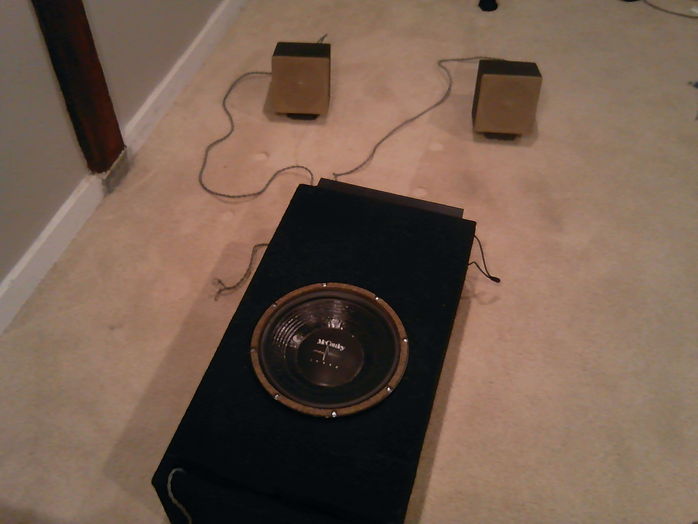
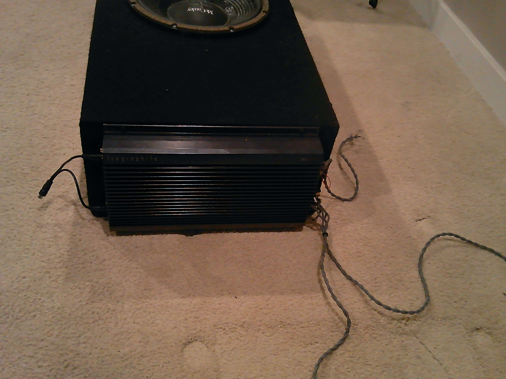
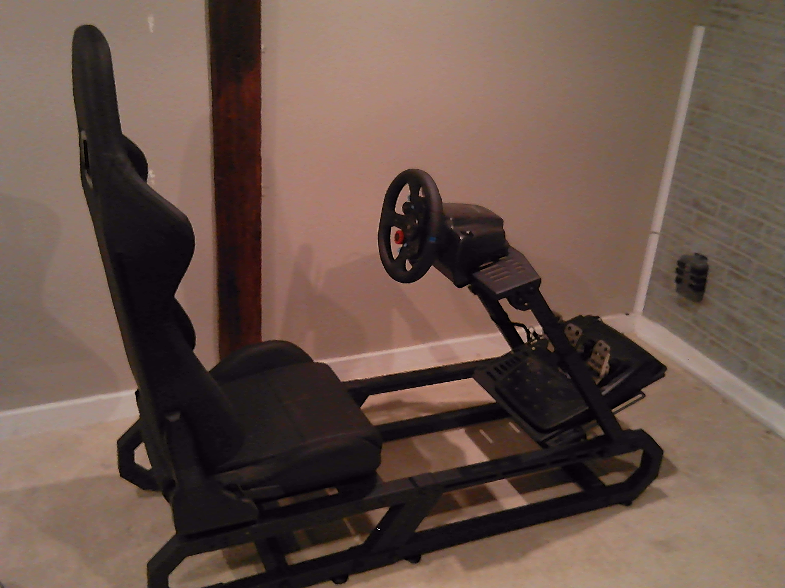
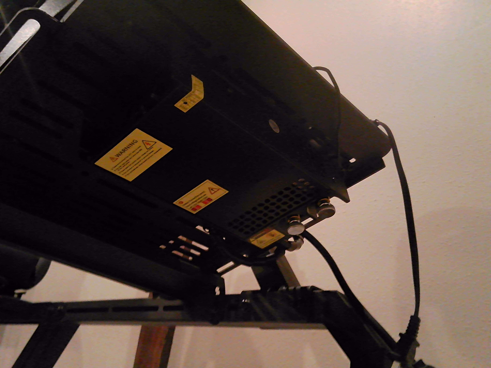
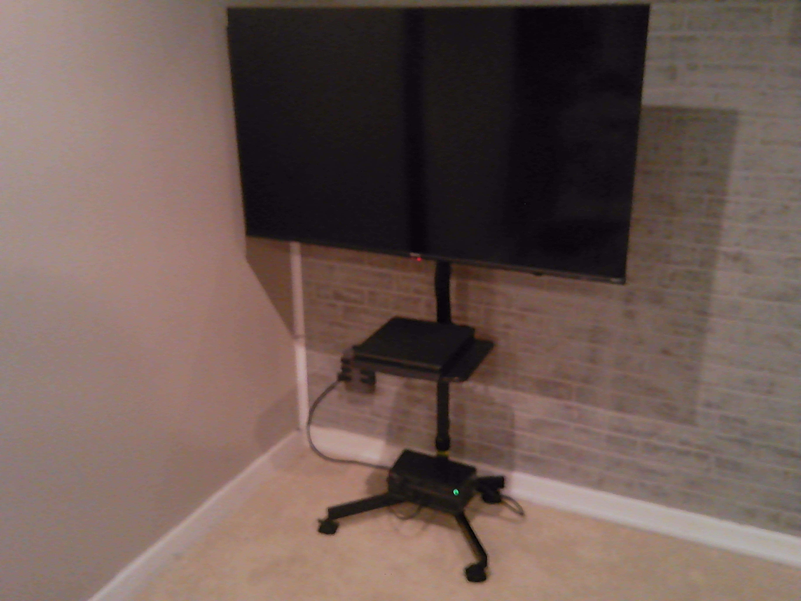

# The rig behind the volume box

[Back to the volume box and 3D viewer](README.md)

## A second life for my college car stereo

I found my old car stereo gear while cleaning out the garage. It had been in my car back in college, and the racing sim gave me a reason to hear it again. The rubber surrounds on the two 6½-inch speakers had pretty much disintegrated, so I replaced them. The 12-inch subwoofer had spent those years in a closet and was still in good shape.

The same 200 W × 4 amplifier that powered my college car stereo now sits on the front of the subwoofer box. I bridged its rear channels to drive the sub. Each front channel drives one 6½-inch coaxial speaker, with a tweeter in the center and a crossover inside its box.

## The cockpit

I started with a VEVOR HC-SE05 cockpit kit and added the Logitech G29. The seat, wheel and pedals share a steel frame. [VEVOR cockpit kit](https://www.vevor.com/racing-wheel-stand-c_11414/vevor-heavy-duty-racing-wheel-stand-for-logitech-g923-g920-g29-max330lbs-compact-p_010243339306) · [Logitech G29 wheel and pedals](https://www.logitechg.com/en-us/shop/p/driving-force-racing-wheel)

The car amplifier needed a 12-volt supply. I mounted a MYSWEETY supply underneath the pedal assembly. It’s rated for up to 66.7 A at 12 V DC. [Stereo power supply](https://www.amazon.com/dp/B0C8HP5PL5)

## From remote work to race day

Years ago, I built a telepresence setup for a remote job. The TV was already on a rolling stand with a shelf below the screen and a small UPS at the base. All I had to do was put the PlayStation on the shelf. Now I can roll the whole setup into place in front of the cockpit.

## Why I built a volume box

My TV could already send the PlayStation’s HDMI audio to the stereo through its headphone jack. The part I didn’t like was reaching for the TV remote every time I wanted to change the volume from the driver’s seat.

I drive with a Logitech G29 wheel and pedals. The wheel has no headphone jack, but a second controller connected to the PlayStation can supply the audio. I plugged the DualShock 4’s headphone output into a Sure Electronics AA-AB41147 volume control board and ran its RCA outputs to the stereo amplifier. That gave me a physical knob I could reach from the cockpit.

One of my earlier versions charged the controller while I drove. Charging introduced enough electrical noise into the audio that I dropped that feature. On this redesign I wanted to tidy up the box and give the controller somewhere to sit.

[See the finished box and interchangeable cradle](README.md)
