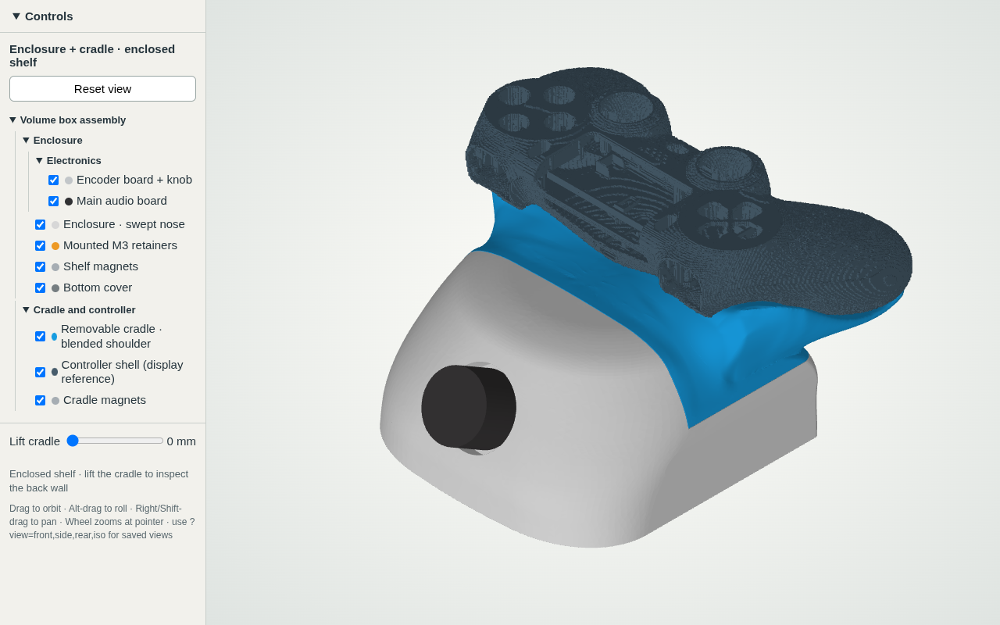
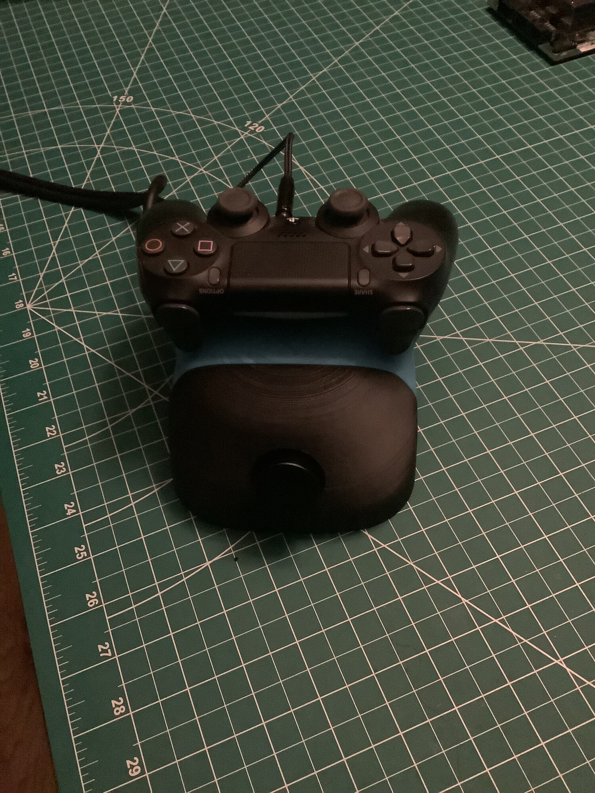
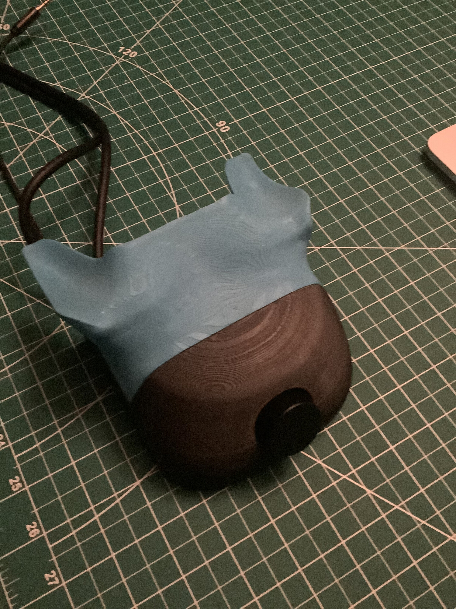
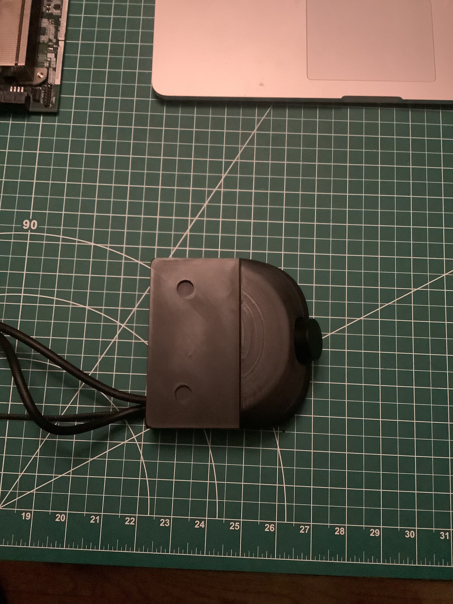
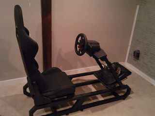

# Designing a racing sim volume box with an interchangeable controller cradle

[Open the interactive 3D viewer](https://thatoneguydavid.github.io/racing-sim-volume-box/)

The audio for my racing sim comes from the headphone jack on a second DualShock 4. It runs through a Sure Electronics AA-AB41147 volume control board and out over RCA to the stereo amplifier, so I can adjust the volume from the driver’s seat.

When I designed the volume box, the top seemed like a natural place for the controller to sit. I added a cradle there to hold it in place and recessed the volume knob into the front of the box.

I made the cradle interchangeable so that another controller could have its own cradle on the same mount. Two pairs of magnets sit in recesses in the cradle and the shelf, so the cradle lifts straight off. The printed cradle fits my DualShock 4, and the revised volume box worked perfectly in my rig.

DualShock 4 seated in the blue cradle above the front volume knob.

The printed cradle with the controller lifted out.

With the cradle removed, the two circular magnet pockets are visible on the shelf.

The open underside shows the audio board and its cable connections.

The photos show the print I tested in my rig. The downloadable revision adds M3 heat-set insert mounts and a wider inside flare around the knob recess. That revision still awaits a test print.

## Design files

Download and extract [the design files](Volume-box-2026-11-27.zip), then open `Volume-study.html` in a browser to rotate the assembly and inspect the parts.

## The rig behind the box

The stereo came out of my college car, and the TV stand came from an old remote-work setup. [Read how the rig came together and why I built the volume box.](RACING-SIM.md)
